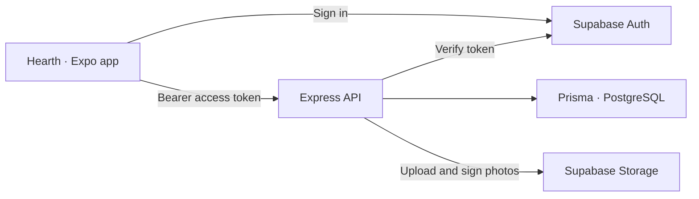

<p align="center">
  
</p>

<h1 align="center">Recipe Book API</h1>

<p align="center">
  The backend behind <strong>Hearth</strong>, a personal cookbook with Cambodian roots.<br />
  Recipes, weekly meal plans, and a market list built from what you’re cooking.
</p>

<p align="center">
  <a href="https://github.com/nak89/recipe-book-mobile"><strong>See the mobile app & screenshots ↗</strong></a>
  &nbsp; · &nbsp;
  <a href="https://recipe-book-mobile.expo.app">Try the app</a>
  &nbsp; · &nbsp;
  <a href="#run-locally">Run locally</a>
</p>

<p align="center">
  
  
  
  
  
</p>

## What it powers

- **A personal cookbook:** recipes with photos, ordered ingredients and steps, favourites, optional nutrition per serving, and step timers.
- **A Cambodian recipe library:** browse eight dishes adapted from Chef Nak’s recipes and copy them into a personal collection without creating duplicate copies.
- **Weekly meal planning:** one recipe per date and mealtime, stored as calendar dates so a plan keeps its day across timezones.
- **A market list that follows the plan:** matching ingredients add together across planned meals; shopping state, quantity corrections, and manually added items are stored separately.
- **Accounts and photos:** Supabase sign-in, authenticated uploads, and signed photo access for user-owned images.

## How it fits together



Supabase owns authentication and photo storage. Express owns recipe business logic and scopes personal data to the caller. There is no Prisma `User` table: each recipe stores the Supabase user ID, while display names stay in auth metadata.

The grocery list is derived from meal-plan ingredients on each read. Only ticks, quantity overrides, and manual items are persisted, so changing a planned meal does not leave a stale stored shopping list behind.

## Run locally

Clone the current implementation:

```bash
git clone https://github.com/nak89/recipe-book-backend.git
cd recipe-book-backend
npm install
```

Create `.env` with values from your Supabase project:

```dotenv
DATABASE_URL=your-postgres-connection-string
SUPABASE_URL=https://your-project.supabase.co
SUPABASE_SECRET_KEY=your-server-secret-key
SUPABASE_PUBLISHABLE_KEY=your-publishable-key
SUPABASE_STORAGE_BUCKET=recipe-photos
```

Use a database connection that supports Prisma migrations; a direct connection or Supabase session pooler is suitable. Create the photo bucket named above. Keep the secret key on the server; the mobile app uses only the publishable key.

```bash
npx prisma generate
npx prisma migrate deploy
npm run dev
```

The API runs at `http://localhost:3000` by default. Follow the [mobile setup](https://github.com/nak89/recipe-book-mobile#run-locally) to connect the app to the same Supabase project and this API.

To add sample recipes to a development account, sign up in the app first and use that account’s Supabase user ID:

```bash
SEED_USER_ID=your-user-id npx prisma db seed
```

Restart the dev server after regenerating the Prisma client.

## API at a glance

Personal data routes require `Authorization: Bearer <supabase-access-token>`.

| Area | Routes | Purpose |
| --- | --- | --- |
| Recipes | `GET /recipes`, `GET /recipes/:id` | Read the caller’s cookbook |
| Editing | `POST /recipes`, `PUT /recipes/:id`, `DELETE /recipes/:id` | Create, replace, or delete a recipe |
| Favourites | `PATCH /recipes/:id/favourite` | Toggle a favourite without replacing the recipe |
| Shared library | `GET /library`, `GET /library/:id` | Browse Cambodian recipes |
| Save from library | `POST /library/:id/copy`, `POST /library/import` | Copy one recipe or the full library |
| Meal plan | `GET /meal-plan?from=YYYY-MM-DD&to=YYYY-MM-DD` | Read a bounded date range |
| Dinner-week drafts | `PUT /meal-plan/week/dinners` | Save a complete dinner draft atomically |
| Plan slots | `PUT /meal-plan/:date/:mealtime`, `DELETE /meal-plan/:date/:mealtime` | Fill or clear one meal slot |
| Market list | `GET /grocery?from=YYYY-MM-DD&to=YYYY-MM-DD` | Derive a Monday–Sunday shopping list |
| Shopping state | `PUT /grocery/line` | Tick a derived line or adjust its weekly quantity |
| Manual items | `POST /grocery/items`, `PATCH /grocery/items/:id`, `DELETE /grocery/items/:id` | Manage extra shopping items |
| Photos | `POST /upload`, `POST /photos/sign` | Upload a photo or request signed access |
| Auth proxy | `POST /auth/signup`, `POST /auth/login` | Auth endpoints; the mobile app uses Supabase Auth directly |

## Project map

```text
index.ts          Express setup, recipes, library, meal plan, and grocery routes
routes/           Auth proxy, photo uploads, and photo signing
middleware/       Authentication, request limiting, and error handling
prisma/           Database schema, migrations, and seed scripts
lib/              Grocery aggregation, photo ownership, and text comparison
data/             Shared Cambodian library and starter packs
validation.ts     Request schemas and input limits
tests/            API integration and security regression tests
```

```bash
npx tsc --noEmit   # Type checking
npm test          # Live API integration tests
npm run test:security
```

The integration suite requires a running server at `TEST_API_URL` (default `http://localhost:3100`) and a development Supabase project. It creates and removes temporary users and data; it is not an offline test suite.

## Recipe credits

The shared library is adapted from [Chef Nak](https://chefnak.com), with source attribution in its data. The Khmer adaptations still need a native-reader review. Recipe content and photography belong to their respective creators.
